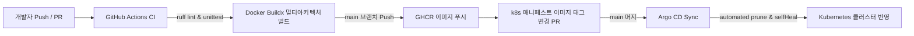

# DevOps 방명록(Guestbook) 프로젝트 보고서

- 작성자: 노태현-202244081
- GitHub ID: `jwbsia772lrn`
- 저장소: `https://github.com/jwbsia772lrn/devops.git`

## 1. 아키텍처 다이어그램



## 2. 기술 스택

| 구분 | 기술 / 도구 | 역할 |
| --- | --- | --- |
| 애플리케이션 | Python 3.12, Flask | 방명록 웹 서버 및 `/healthz`, `/readyz`, `/api/entries` API 제공 |
| 데이터 저장소 | Redis 7 (`redis:7-alpine`) | 방문자 수 카운트 및 방명록 목록 영속화 (미설정 시 메모리 모드 동작) |
| 컨테이너 | Docker, Docker Compose | 멀티스테이지/레이어 캐시 최적화 이미지 빌드 및 로컬 멀티 컨테이너 실행 |
| 오케스트레이션 | Kubernetes (Minikube) | Deployment, Service, ConfigMap, Secret, Health Probe 기반 운영 |
| CI 파이프라인 | GitHub Actions | `ruff` 정적 검사, `unittest` 검증, GHCR 멀티아키텍처 이미지 빌드 및 푸시 |
| GitOps CD | Argo CD | `guestbook/k8s` 경로 감시 및 클러스터 자동 동기화 |

## 3. 실행 방법

### 3.1 Docker Compose 로컬 실행

```bash
cd guestbook
cp .env.example .env
docker compose up -d --build
```

- 접속 확인: `http://localhost:8080`
- 종료 및 볼륨 정리: `docker compose down -v`

### 3.2 Minikube 및 Kubernetes 매니페스트 수동 실행

```bash
minikube start
cp guestbook/k8s/secret.yaml.example guestbook/k8s/secret.yaml
kubectl apply -f guestbook/k8s/secret.yaml
kubectl apply -f guestbook/k8s/
kubectl get pods,svc
minikube service guestbook --url
```

### 3.3 Argo CD GitOps 연결 및 배포 확인

```bash
kubectl create namespace argocd
kubectl apply -n argocd -f https://raw.githubusercontent.com/argoproj/argo-cd/stable/manifests/install.yaml
kubectl apply -f guestbook/k8s/secret.yaml
kubectl apply -f argocd-application.yaml
kubectl get application -n argocd
```

- Argo CD는 `https://github.com/jwbsia772lrn/devops.git` 저장소의 `main` 브랜치 `guestbook/k8s` 디렉터리를 감시하며, `prune: true` 및 `selfHeal: true` 옵션으로 선언적 상태를 유지합니다.

## 4. 설정 분리 설명 (ConfigMap과 Secret)

- **ConfigMap (`guestbook-config`)**: 민감하지 않은 일반 설정(`APP_TITLE`, `THEME_COLOR`, `REDIS_HOST`, `REDIS_PORT`)을 키-값 형태로 저장하고 `deployment.yaml`의 `envFrom.configMapRef`를 통해 컨테이너 환경 변수로 일괄 주입합니다.
- **Secret (`guestbook-secret`)**: `REDIS_PASSWORD`와 같은 민감 정보를 저장하며, `.gitignore`에 `guestbook/k8s/secret.yaml`을 등록해 Git 저장소 유출을 방지하고 템플릿 파일(`secret.yaml.example`)만 버전 관리합니다.
  - `guestbook` Deployment는 `envFrom.secretRef`로 전체 주입합니다.
  - `redis` Deployment는 `env.valueFrom.secretKeyRef`로 `REDIS_PASSWORD` 키를 참조해 `--requirepass $(REDIS_PASSWORD)` 인자에 전달합니다.
