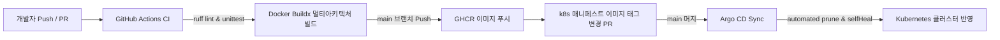

# DevOps 방명록(Guestbook) 프로젝트 보고서

- 작성자: 노태현-202244081
- GitHub ID: `jwbsia772lrn`
- 저장소: `https://github.com/jwbsia772lrn/devops.git`

## 1. 아키텍처 다이어그램



## 2. 기술 스택

| 구분 | 기술 / 도구 | 역할 |
| --- | --- | --- |
| 애플리케이션 | Python 3.12, Flask | 방명록 웹 서버 및 `/healthz`, `/readyz`, `/api/entries` API 제공 |
| 데이터 저장소 | Redis 7 (`redis:7-alpine`) | 방문자 수 카운트 및 방명록 목록 영속화 (미설정 시 메모리 모드 동작) |
| 컨테이너 | Docker, Docker Compose | 멀티스테이지/레이어 캐시 최적화 이미지 빌드 및 로컬 멀티 컨테이너 실행 |
| 오케스트레이션 | Kubernetes (Minikube) | Deployment, Service, ConfigMap, Secret, Health Probe 기반 운영 |
| CI 파이프라인 | GitHub Actions | `ruff` 정적 검사, `unittest` 검증, GHCR 멀티아키텍처 이미지 빌드 및 푸시 |
| GitOps CD | Argo CD | `guestbook/k8s` 경로 감시 및 클러스터 자동 동기화 |

## 3. 실행 방법

### 3.1 Docker Compose 로컬 실행

```bash
cd guestbook
cp .env.example .env
docker compose up -d --build
```

- 접속 확인: `http://localhost:8080`
- 종료 및 볼륨 정리: `docker compose down -v`

### 3.2 Minikube 및 Kubernetes 매니페스트 수동 실행

```bash
minikube start
cp guestbook/k8s/secret.yaml.example guestbook/k8s/secret.yaml
kubectl apply -f guestbook/k8s/secret.yaml
kubectl apply -f guestbook/k8s/
kubectl get pods,svc
minikube service guestbook --url
```

### 3.3 Argo CD GitOps 연결 및 배포 확인

```bash
kubectl create namespace argocd
kubectl apply -n argocd -f https://raw.githubusercontent.com/argoproj/argo-cd/stable/manifests/install.yaml
kubectl apply -f guestbook/k8s/secret.yaml
kubectl apply -f argocd-application.yaml
kubectl get application -n argocd
```

- Argo CD는 `https://github.com/jwbsia772lrn/devops.git` 저장소의 `main` 브랜치 `guestbook/k8s` 디렉터리를 감시하며, `prune: true` 및 `selfHeal: true` 옵션으로 선언적 상태를 유지합니다.

## 4. 설정 분리 설명 (ConfigMap과 Secret)

- **ConfigMap (`guestbook-config`)**: 민감하지 않은 일반 설정(`APP_TITLE`, `THEME_COLOR`, `REDIS_HOST`, `REDIS_PORT`)을 키-값 형태로 저장하고 `deployment.yaml`의 `envFrom.configMapRef`를 통해 컨테이너 환경 변수로 일괄 주입합니다.
- **Secret (`guestbook-secret`)**: `REDIS_PASSWORD`와 같은 민감 정보를 저장하며, `.gitignore`에 `guestbook/k8s/secret.yaml`을 등록해 Git 저장소 유출을 방지하고 템플릿 파일(`secret.yaml.example`)만 버전 관리합니다.
  - `guestbook` Deployment는 `envFrom.secretRef`로 전체 주입합니다.
  - `redis` Deployment는 `env.valueFrom.secretKeyRef`로 `REDIS_PASSWORD` 키를 참조해 `--requirepass $(REDIS_PASSWORD)` 인자에 전달합니다.

## 5. 트러블슈팅 사례

### 사례 1: Windows WSL 환경에서 `*:Zone.Identifier` 메타데이터 파일 커밋 문제

- **증상**: WSL 환경에서 파일을 복사하거나 다운로드한 뒤 `git status` 확인 시 의도하지 않은 `*:Zone.Identifier` 파일이 함께 추적되어 저장소가 오염됨.
- **확인**: `git status` 및 `find . -name "*:Zone.Identifier"` 명령으로 Windows NTFS Alternate Data Stream에서 생성된 메타데이터 파일 존재 여부 확인.
- **원인**: Windows에서 다운로드하거나 이동한 파일이 WSL 경로로 복사될 때 보안 영역 정보(`Zone.Identifier`)가 별도 파일로 생성되며, `.gitignore`에 제외 패턴이 누락되어 있었음.
- **조치**: 루트 `.gitignore`에 `*:Zone.Identifier` 규칙을 추가하고, 기존 추적된 메타데이터 파일을 `find . -name "*:Zone.Identifier" -delete`로 삭제함.
- **결과**: 이후 `git status`에서 메타데이터 파일이 더 이상 노출되지 않으며 깔끔한 커밋 이력 유지 가능.

### 사례 2: Kubernetes 배포 시 `CreateContainerConfigError` 및 `ImagePullBackOff` 발생

- **증상**: `kubectl apply -f guestbook/k8s/` 실행 후 `guestbook` Pod가 `CreateContainerConfigError` 또는 `ImagePullBackOff` 상태로 대기하며 `Running`으로 전환되지 않음.
- **확인**: `kubectl describe pod <pod-name>` 실행 결과 `secret "guestbook-secret" not found` 또는 `ghcr.io/jwbsia772lrn/guestbook:v1` 이미지 Pull 실패 메시지 확인.
- **원인**: `.gitignore`로 제외된 `secret.yaml`을 클러스터에 사전 적용하지 않았거나, GHCR 패키지가 비공개(Private) 상태이거나 지정된 이미지 태그(`v1`)가 아직 푸시되지 않음.
- **조치**: `secret.yaml.example`을 기반으로 `secret.yaml`을 생성해 `kubectl apply -f guestbook/k8s/secret.yaml`로 먼저 반영하고, GHCR 패키지 공개 설정 또는 GitHub Actions에서 푸시된 태그와 `deployment.yaml`의 이미지 태그를 일치시킴.
- **결과**: Pod가 정상적으로 이미지를 Pull하고 환경 변수를 주입받아 `readinessProbe`(`/readyz`) 및 `livenessProbe`(`/healthz`)를 통과하며 `Running (1/1)` 상태로 전환됨.

## 6. 도구 사용 후기 및 회고

- **Docker & Docker Compose**: `Dockerfile`에서 `requirements.txt`를 먼저 복사해 레이어 캐시를 활용하고 `appuser` 비루트 사용자로 전환하는 보안 모범 사례를 체감했습니다. Compose의 `depends_on`과 `healthcheck` 조합으로 Redis가 준비된 뒤 웹 앱이 기동되도록 제어할 수 있었습니다.
- **Kubernetes**: ConfigMap과 Secret으로 설정과 코드를 분리하고, `/healthz`·`/readyz` 프로브와 리소스 제한(`requests`/`limits`)을 통해 무중단 서비스에 필요한 선언적 운영 방식을 이해했습니다.
- **CI/CD & GitOps**: GitHub Actions에서 `ruff`와 `unittest`로 품질을 검증한 뒤 멀티아키텍처 이미지를 GHCR에 자동 배포하고, Argo CD가 Git 저장소의 선언적 상태를 클러스터와 자동으로 동기화하는 GitOps 파이프라인의 전체 흐름을 구축하며 DevOps 자동화의 가치를 실감했습니다.
